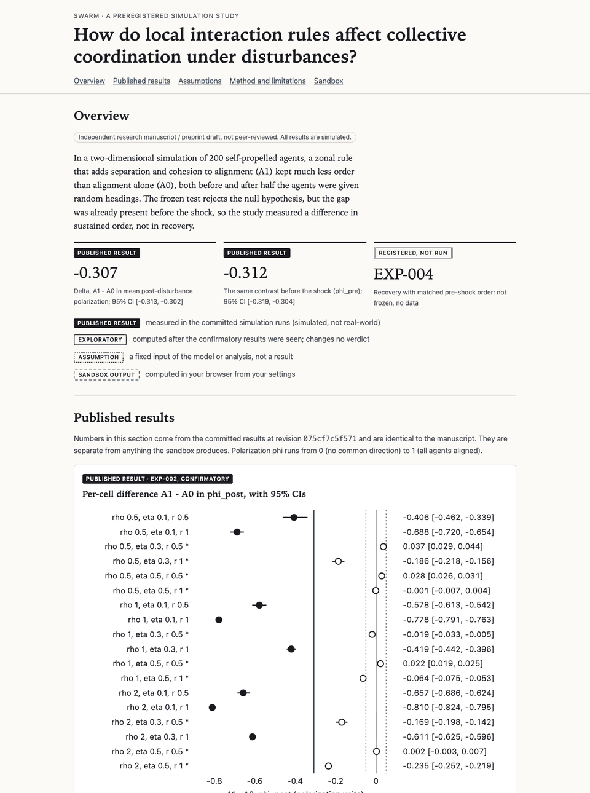

<!-- SPDX-License-Identifier: LicenseRef-SWARM-NC-Research-1.0 -->
# SWARM

**Manuscript (owner-approved title):** *A zonal separation-cohesion rule sustains less order than alignment alone, and the design did not measure recovery: a preregistered simulation comparison under a heading shock.* Independent research manuscript / preprint draft, not peer-reviewed. All results are simulated.

**Question.** How do local interaction rules affect collective coordination under disturbances?

**Why it matters.** Local rules are often said to produce coordinated motion without a leader. Whether adding separation and cohesion to alignment helps or hurts a group's response to a disturbance is a narrower question that a matched, preregistered comparison can answer within a model. Nothing here is a claim about real animals, robots or distributed systems in general.

## Status (2026-11-26)

M0 to M5 are done. M6: a release candidate (version 0.1.0-rc1) is prepared and awaits the owner's review and approval to publish; the manuscript and report PDFs are in `research/paper/` and `research/experiments/EXP-00N/`. The owner has approved the manuscript title and the funding, competing-interest and AI-use statements (2026-11-25). The repository is public at https://github.com/mohamedbechirkefi/swarm-local-coordination since 2026-11-25 (owner, 2026-11-26, decision sheet, A1); no tag or release exists yet.

## What is implemented

A 2-D self-propelled particle simulator (`src/swarm/`) with three rules under a matched heading disturbance: A0 alignment only (baseline), A1 separation, alignment and cohesion (zonal, cohesion weight 0.5), and A2 a centralized global-alignment reference. Cell-list neighbour search verified against brute force, seeded common random numbers across arms, a versioned result schema, run manifests, a report generator, a frozen analysis script and a static demo page (`demo/`).

## Experiments

| Experiment | Purpose | Status | Result |
| --- | --- | --- | --- |
| EXP-001 | Implementation verification and smoke matrix | exploratory, complete | verification checks pass |
| EXP-002 | Primary comparison, 1,080 runs | confirmatory, complete, 0 failed | Delta = -0.307 [-0.313, -0.302], rejects H0; the same gap exists before the shock (-0.312 [-0.319, -0.304]) |
| EXP-003 | Sensitivity, 480 runs | confirmatory, complete, 0 failed | no condition invalidates or weakens EXP-002 |
| EXP-004 | Recovery with matched pre-shock order | registered, not frozen; not run | none (no data) |

## Key findings (simulated, tested grid only)

- At cohesion weight 0.5, A1 holds much less order than A0: the primary contrast in mean post-disturbance polarization is Delta = -0.307 (95% stratified bootstrap CI [-0.313, -0.302]) over 18 cells and 20 matched seeds each. The frozen rule rejects H0.
- The gap is present before the shock (-0.312 [-0.319, -0.304]), so the study measured a difference in sustained order, not in recovery. The design could not measure A1's recovery of order.
- Four frozen sensitivity conditions keep the sign and exclude zero (topological neighbours -0.415 [-0.429, -0.398]; cohesion 0.25 -0.268 [-0.282, -0.257]; cohesion 1.0 -0.507 [-0.515, -0.498]; reflecting walls -0.449 [-0.463, -0.434]).
- Exploratory, post hoc: the paired change score is 0.004 [-0.004, 0.012], inside the smallest effect of interest. This removes the "A1 recovers worse" reading but does not show equal recovery.

Limitations: `research/limitations.md`. Claims and their evidence: `research/claims_register.csv` and `research/publication/artifact_manifest.json`.

## Research navigation

- Manuscript: `research/paper/manuscript.md` (supplementary: `research/paper/supplementary.md`).
- Experiment reports: `research/experiments/EXP-001/report.md`, `EXP-002/report.md`, `EXP-003/report.md`; EXP-004 has a draft protocol only (registered, not frozen, not run; the owner will freeze later).
- Protocols and freeze record: `research/protocol.md`, `research/protocol_freeze.json`.
- Decisions: `research/decision_log.md`. Working journal: `progress.md`.

## Quick start

    uv sync --frozen
    uv run python -m pytest -q
    uv run python -m swarm.cli smoke --config experiments/EXP-001/smoke.json

(`uv` 0.9.5 was used; the PDF builder expects pandoc 3.6.3 and the `typst` Python package, located by default in `../.tools/` or set with `SWARM_PANDOC` and `SWARM_TYPST_PYTHON`.)

Demo page (static, offline after the first load, no runtime service):

    cd demo && npm ci && npm run build && npm run preview

The page reads `demo/public/data/results.json`, written by `scripts/export_demo_data.py` from committed results only. The sandbox runs a browser port of the engine's update rules in a Web Worker; it is labelled sandbox output and never mixed with published results. Repository: https://github.com/mohamedbechirkefi/swarm-local-coordination. Demo: https://swarm-local-coordination.kefimohamedbechir.workers.dev (Cloudflare Workers static assets, free plan; see `demo/README.md`).

Full reproduction: `research/experiments/EXP-00N/reproduction.md`. All commands: `CONTRIBUTING.md`.

## Architecture

`src/swarm/` (config, geometry, neighbours, rules, metrics, simulate, runner, schema, report, CLI) -> `experiments/` (frozen configs, analysis and audit scripts) -> `results/` (committed metrics, analyses, SHA-256 manifests) -> `research/` (protocols, reports, manuscript, registers) and `scripts/export_demo_data.py` -> `demo/` (TypeScript, React and Vite static page).

## Data and licences

All data are synthetic (decision DL-003). Third-party dependencies keep their own licences (`uv.lock`, `demo/package-lock.json`).

## Licence

SWARM Source-Available Non-Commercial Research License v1.0 (`LicenseRef-SWARM-NC-Research-1.0`), a custom licence chosen by the owner; it is not an OSI-approved open-source licence. See `LICENSE`, `NOTICE.md`, `CLA.md`.

## Citation

See `CITATION.cff`. Author: Mohamed Bechir Kefi, independent researcher. No funding was received. The author declares no competing interests.
