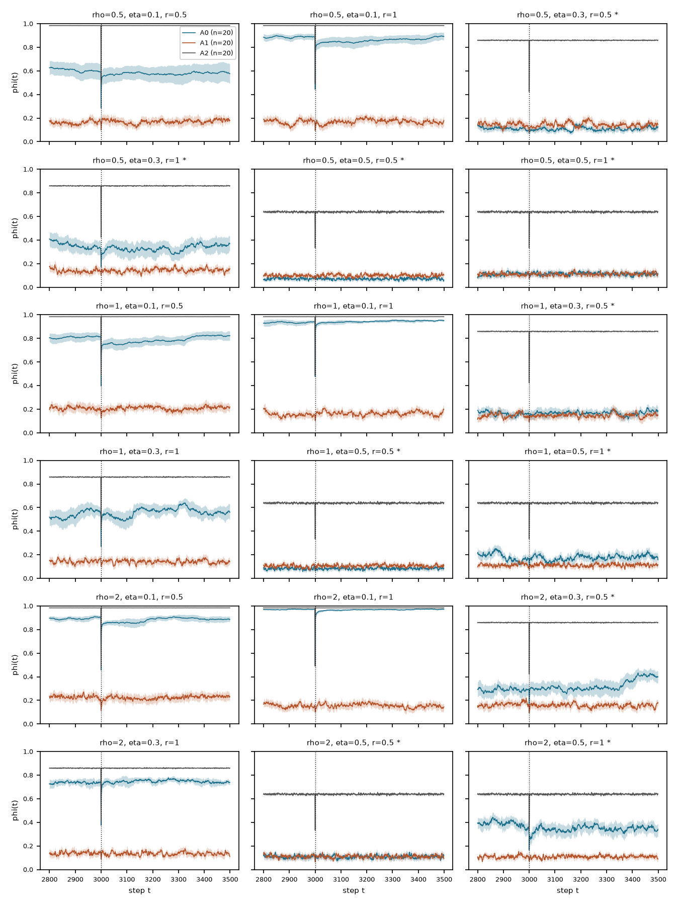

<!-- SPDX-License-Identifier: LicenseRef-SWARM-NC-Research-1.0 -->
# EXP-002 report: local rules and recovery from a heading disturbance

All results are simulated. This is a confirmatory experiment under protocol v1.0 (frozen, owner-approved 2026-11-24).

## 1. Identification

- **Experiment.** EXP-002, the primary comparison. Runs were made on 2026-11-24/25 UTC. Report version 1.0.
- **Status.** Complete: 1080 of 1080 planned runs, 0 failed, none excluded.
- **Author.** Mohamed Bechir Kefi, independent researcher (owner-approved metadata, DL-010; owner, 2026-11-26, decision sheet, B3). The AI was a research and development assistant, not an author.
- **Protocol hashes** (`research/protocol_freeze.json`):
  - `research/protocol.md`: 80c7225dc55d3065b7bd92d683cb71423c1cf511dd215385ee7a8dc59db109d4.
  - `research/experiments/EXP-002/protocol.md`: 3359f833014d145abec739d3ccb3de63587f94191dec523a38ec37f0f53b0c5e.
- **Config.** `experiments/EXP-002/config.json`:
  - file SHA-256: b76bb1c013944d790ddb0f43da83b38203679c03f35ad014cffc8f54f3cf750c;
  - canonical hash: ffa4a8e818c473822279053d00a08160b868b51d07444804396393225f8243a2.
- **Code revision of every run.** `075cf7c5f571c03ede9b8d551c3ba43766172a39`, with `git_dirty: false` for all 1080 runs.
- **Analysis generator.** `experiments/analyse_confirmatory.py`, committed in `075cf7c` before any confirmatory output existed (DL-012).
- **Written.** After M3, from committed results only, on the owner's approval of 2026-11-25 (DL-014).

## 2. Executive summary

- **Question.** Does adding separation and cohesion to alignment (A1) change mean post-disturbance polarization phi_post compared with alignment alone (A0)? The comparison uses matched seeds across 18 density x noise x radius cells.
- **Method.**
  - 3 arms x 18 cells x 20 seeds = 1080 simulated runs.
  - Heading shock to half the agents at t_d = 3000.
  - Pooled paired difference with a stratified seed bootstrap.
- **Outcome.**
  - Delta = phi_post(A1) - phi_post(A0) = -0.307, 95% CI [-0.313, -0.302], over 360 (cell, seed) pairs.
  - The CI excludes 0, so the result **rejects H0** under the frozen rule.
- **Principal caveat.** This is not a recovery effect.
  - A1 is already disordered before the shock in every cell (A1 mean phi_pre 0.097 to 0.229).
  - The pre-shock contrast is phi_pre A1 - A0 = -0.312 [-0.319, -0.304], almost equal to Delta.
  - The result therefore measures A1's lower stationary order at w_c = 0.5, not worse recovery from the disturbance (limitation 13).

## 3. Rationale and literature

- Alignment-only models show a noise- and density-driven transition between disordered and ordered motion (Vicsek et al., 1995).
- Zonal models with repulsion, orientation and attraction show distinct collective states and history dependence (Couzin et al., 2002).
- Jadbabaie, Lin and Morse (2003) studied nearest-neighbour coordination rules for mobile agents. Only the bibliographic record was accessed, so this report does not characterise their results (M4 evidence audit, 2026-11-25; an earlier wording said that such rules converge under connectivity conditions, which no read source supported). M6 note (2026-11-25): the full text was then consulted to confirm the topic only; this wording is unchanged.
- Flocking designs add separation and cohesion terms (Olfati-Saber, 2006).
- Cohesion might therefore keep the neighbour graph connected after a shock and help recovery, while repulsion might inject heading changes and hurt it. H1 was nondirectional for that reason.
- **Gap.** A matched-seed, disturbance-focused comparison with a centralized reference and seed-level uncertainty. Novelty is not claimed, and the literature review is not systematic.

## 4. Hypotheses and operational definitions

- **phi(t).** phi(t) = |(1/N) sum_i exp(i theta_i(t))|, dimensionless in [0, 1].
- **phi_post and phi_pre.** phi_post is the mean of phi over t in [3000, 3500). phi_pre is the mean over [2900, 3000).
- **Delta.** The equal-weight mean over the 18 cells of the within-cell mean paired difference phi_post(A1) - phi_post(A0). Pairs share a seed, and with it the initial state, noise and shock (common random numbers).
- **Hypotheses.** H0: Delta = 0. H1: Delta != 0 (two-sided). SESOI = 0.05.
- **Decision rule.**
  - If the 95% CI excludes 0, H0 is rejected.
  - If the CI lies within (-0.05, 0.05), the result is practically equivalent.
  - Otherwise it is inconclusive.
  - A CI containing 0 would contradict H1.
- **Secondary metrics (descriptive).**
  - phi_pre.
  - Recovery time tau: the first step after t_d from which phi >= 0.9 phi_pre for 10 steps, censored at W = 500.
  - Cohesion C: the largest-component fraction of the radius-r graph over the post window.
  - Collisions per agent per 100 steps.
  - Distance evaluations and wall-clock per step.

## 5. Methodology

- **Model.**
  - 2-D self-propelled particles: N = 200, speed v0 = 0.05 u/step.
  - Periodic square box; metric neighbourhoods searched with a cell list.
  - Uniform heading noise on (-eta pi, eta pi); synchronous updates.
  - The shock at t_d gives half the agents (chosen by the disturbance stream) uniform random headings. These are identical across arms for a given seed.
- **Arms.**
  - A0: alignment only (control).
  - A1: zonal rule. Separation has priority within r_s = 0.25 r; otherwise the agent combines alignment (w_a = 1) and cohesion (w_c = 0.5).
  - A2: global-mean alignment, a descriptive ceiling.
- **Grid.** rho in {0.5, 1, 2}, eta in {0.1, 0.3, 0.5}, r in {0.5, 1}, seeds 1001 to 1020; T = 3500, t_d = 3000, W = 500.
- **Data.** Synthetic only (DL-003). The data manifest `data/manifest.json` has SHA-256 94fe5a7ba3b9bfde343e967d073ca77e2bb4d100d7f62933eb608d746a623471, recorded in `launch.json` and in every row of `provenance.csv`.
- **Statistics.**
  - Stratified percentile bootstrap: seeds resampled with replacement within each cell, 10,000 resamples, seed 20261124, 95% CI.
  - Per-cell CIs are descriptive (no per-cell tests).
  - Exclusion only for software failure; more than 5% failed runs in an arm stops the analysis.
- **Hardware and software.** Apple M1 Pro (10 cores, 16 GB), macOS 15.3.1, Python 3.12.1, numpy 2.5.4. Runs used 2 worker processes under `nice -n 10`.
- **Budget.** 4 hours wall-clock (frozen).

## 6. Implementation verification

- **Before the runs.**
  - The full test suite passed: 133 tests at `075cf7c`.
  - EXP-001 passed, and the M3 smoke re-run reproduced the pre-freeze smoke exactly.
  - All 3 protocol hashes and all 4 config hashes matched the freeze record.
- **Every run.**
  - phi_pre, phi_post and tau were recomputed from the stored phi series, and the bounds were checked.
  - Result: 1080 runs checked, 0 mismatches.
- **Faithfulness.**
  - A1 reduces exactly to A0 when r_s = 0 and w_c = 0 (test), so A1 - A0 isolates the separation and cohesion terms.
  - Those terms also change the effective coupling; EXP-003 S2 probes that.

## 7. Execution record

- **Command.** `nice -n 10 .venv/bin/python -m swarm.cli run --config experiments/EXP-002/config.json --workers 2`. Provenance came from `experiments/provenance.py prelaunch` before the run and `finalize` after it.
- **Timing.**
  - Started 2026-11-24 23:34:39 UTC and finished 23:54:05 UTC.
  - 1138.7 s elapsed (`execution.json`), against a 4-hour budget.
  - The load average from unrelated processes was 16.3 at launch, so wall-clock figures are inflated.
- **Sample counts.** 1080 runs recorded, 1080 ok, 0 failed, 0 excluded. The failure rate is 0 in every arm, and every cell has 20 pairs.
- **Run IDs.** `EXP-002_<arm>_density<rho>_noise<eta>_radius<r>_s<seed>`, listed in `results/confirmatory/EXP-002/provenance.csv`. Each row has the config hash, seed, revision, data manifest hash, hardware, start and end times, and status.
- **Deviations from the frozen protocol.**
  - None in design, seeds or analysis.
  - Execution detail: 2 worker processes instead of the 8 in the protocol's example command (M3 compute limit, DL-012). Each run is single-threaded and seeded, so this cannot change any output.
  - Analysis implementation choices were fixed before any data (DL-012).

## 8. Results

### Primary analysis and pooled contrasts

<!-- BEGIN GENERATED:exp002-primary -->
| quantity | value |
| --- | --- |
| Runs recorded / failed | 1080 / 0 |
| Cells / independent (cell, seed) pairs | 18 / 360 |
| Delta = A1 - A0 in phi_post, 95% CI | -0.307 [-0.313, -0.302] |
| Decision under the frozen rule (SESOI 0.05) | rejects H0 |
| Delta restricted to the 4 EXP-003 cells (descriptive) | -0.434 [-0.443, -0.424] |
| Reference A2-A0 in phi_post (descriptive) | 0.374 [0.369, 0.379] |
| Reference A2-A1 in phi_post (descriptive) | 0.681 [0.679, 0.684] |
| Secondary phi_pre, A1-A0 (descriptive) | -0.312 [-0.319, -0.304] |
| Secondary phi_pre, A2-A0 (descriptive) | 0.371 [0.364, 0.377] |
| Secondary cohesion_post, A1-A0 (descriptive) | 0.080 [0.065, 0.094] |
| Secondary cohesion_post, A2-A0 (descriptive) | -0.210 [-0.218, -0.202] |
| Secondary collisions_per_agent_per_100, A1-A0 (descriptive) | -2.951 [-3.027, -2.874] |
| Secondary collisions_per_agent_per_100, A2-A0 (descriptive) | -2.174 [-2.258, -2.089] |
| Metric check: runs recomputed from series / mismatches | 1080 / 0 |
<!-- END GENERATED:exp002-primary -->

### Per-cell results (means over 20 seeds; A1 - A0 and A2 - A0 with descriptive 95% CIs)

<!-- BEGIN GENERATED:exp002-cells -->
| cell | flag | A0 phi_pre | A1 phi_pre | A2 phi_pre | A0 phi_post | A1 phi_post | A2 phi_post | A1 - A0 [95% CI] | A2 - A0 [95% CI] |
| --- | --- | --- | --- | --- | --- | --- | --- | --- | --- |
| rho=0.5, eta=0.1, r=0.5 |  | 0.596 | 0.166 | 0.984 | 0.576 | 0.170 | 0.983 | -0.406 [-0.462, -0.339] | 0.406 [0.351, 0.471] |
| rho=0.5, eta=0.1, r=1 |  | 0.888 | 0.168 | 0.984 | 0.858 | 0.170 | 0.983 | -0.688 [-0.720, -0.654] | 0.125 [0.096, 0.157] |
| rho=0.5, eta=0.3, r=0.5 | A0 not aligned before the shock | 0.108 | 0.145 | 0.859 | 0.108 | 0.144 | 0.858 | 0.037 [0.029, 0.044] | 0.751 [0.746, 0.755] |
| rho=0.5, eta=0.3, r=1 | A0 not aligned before the shock | 0.338 | 0.135 | 0.859 | 0.331 | 0.144 | 0.858 | -0.186 [-0.218, -0.156] | 0.528 [0.496, 0.557] |
| rho=0.5, eta=0.5, r=0.5 | A0 not aligned before the shock | 0.071 | 0.097 | 0.638 | 0.071 | 0.099 | 0.638 | 0.028 [0.026, 0.031] | 0.567 [0.565, 0.569] |
| rho=0.5, eta=0.5, r=1 | A0 not aligned before the shock | 0.116 | 0.108 | 0.638 | 0.114 | 0.112 | 0.638 | -0.001 [-0.007, 0.004] | 0.524 [0.520, 0.529] |
| rho=1, eta=0.1, r=0.5 |  | 0.813 | 0.207 | 0.984 | 0.785 | 0.207 | 0.983 | -0.578 [-0.613, -0.542] | 0.198 [0.168, 0.228] |
| rho=1, eta=0.1, r=1 |  | 0.934 | 0.151 | 0.984 | 0.942 | 0.165 | 0.983 | -0.778 [-0.791, -0.763] | 0.040 [0.033, 0.049] |
| rho=1, eta=0.3, r=0.5 | A0 not aligned before the shock | 0.156 | 0.147 | 0.859 | 0.167 | 0.148 | 0.858 | -0.019 [-0.033, -0.005] | 0.692 [0.678, 0.706] |
| rho=1, eta=0.3, r=1 |  | 0.570 | 0.146 | 0.859 | 0.561 | 0.142 | 0.858 | -0.419 [-0.442, -0.396] | 0.297 [0.278, 0.318] |
| rho=1, eta=0.5, r=0.5 | A0 not aligned before the shock | 0.082 | 0.100 | 0.638 | 0.084 | 0.106 | 0.638 | 0.022 [0.019, 0.025] | 0.554 [0.552, 0.556] |
| rho=1, eta=0.5, r=1 | A0 not aligned before the shock | 0.157 | 0.115 | 0.638 | 0.176 | 0.112 | 0.638 | -0.064 [-0.075, -0.053] | 0.462 [0.451, 0.472] |
| rho=2, eta=0.1, r=0.5 |  | 0.896 | 0.229 | 0.984 | 0.880 | 0.223 | 0.983 | -0.657 [-0.686, -0.624] | 0.103 [0.087, 0.121] |
| rho=2, eta=0.1, r=1 |  | 0.972 | 0.153 | 0.984 | 0.966 | 0.156 | 0.983 | -0.810 [-0.824, -0.795] | 0.017 [0.015, 0.019] |
| rho=2, eta=0.3, r=0.5 | A0 not aligned before the shock | 0.290 | 0.174 | 0.859 | 0.325 | 0.156 | 0.858 | -0.169 [-0.198, -0.142] | 0.533 [0.504, 0.561] |
| rho=2, eta=0.3, r=1 |  | 0.735 | 0.139 | 0.859 | 0.746 | 0.134 | 0.858 | -0.611 [-0.625, -0.596] | 0.113 [0.101, 0.125] |
| rho=2, eta=0.5, r=0.5 | A0 not aligned before the shock | 0.108 | 0.109 | 0.638 | 0.108 | 0.110 | 0.638 | 0.002 [-0.003, 0.007] | 0.530 [0.526, 0.534] |
| rho=2, eta=0.5, r=1 | A0 not aligned before the shock | 0.381 | 0.111 | 0.638 | 0.344 | 0.108 | 0.638 | -0.235 [-0.252, -0.219] | 0.294 [0.278, 0.311] |
<!-- END GENERATED:exp002-cells -->

### Secondary metrics per cell (descriptive)

<!-- BEGIN GENERATED:exp002-secondary -->
| cell | A0 tau median (censored of 20) | A1 tau median (censored) | A2 tau median (censored) | A0 / A1 / A2 wall-clock ms per step | A0 / A1 / A2 distance evaluations per step |
| --- | --- | --- | --- | --- | --- |
| rho=0.5, eta=0.1, r=0.5 | 7.5 (2) | 9.0 (0) | 1.0 (0) | 0.588 / 1.195 / 0.111 | 1180 / 2221 / 115 |
| rho=0.5, eta=0.1, r=1 | 2.0 (1) | 41.0 (0) | 1.0 (0) | 0.939 / 1.474 / 0.143 | 2039 / 4000 / 487 |
| rho=0.5, eta=0.3, r=0.5 | 30.0 (1) | 42.0 (0) | 1.0 (0) | 0.451 / 0.708 / 0.113 | 271 / 1687 / 115 |
| rho=0.5, eta=0.3, r=1 | 18.0 (2) | 17.5 (0) | 1.0 (0) | 0.819 / 1.077 / 0.146 | 1300 / 3390 / 488 |
| rho=0.5, eta=0.5, r=0.5 | 126.5 (0) | 42.5 (0) | 1.0 (0) | 0.396 / 0.432 / 0.115 | 147 / 788 / 116 |
| rho=0.5, eta=0.5, r=1 | 19.0 (1) | 19.5 (0) | 1.0 (0) | 0.536 / 0.687 / 0.148 | 668 / 2008 / 490 |
| rho=1, eta=0.1, r=0.5 | 3.5 (0) | 17.5 (0) | 1.0 (0) | 0.746 / 1.089 / 0.123 | 1706 / 3218 / 224 |
| rho=1, eta=0.1, r=1 | 1.0 (0) | 11.0 (1) | 1.0 (0) | 0.835 / 1.385 / 0.185 | 2291 / 5752 / 903 |
| rho=1, eta=0.3, r=0.5 | 18.5 (0) | 34.0 (0) | 1.0 (0) | 0.419 / 0.862 / 0.125 | 576 / 2421 / 225 |
| rho=1, eta=0.3, r=1 | 10.5 (0) | 14.0 (0) | 1.0 (0) | 0.792 / 1.150 / 0.187 | 2086 / 4777 / 906 |
| rho=1, eta=0.5, r=0.5 | 75.5 (0) | 36.5 (0) | 1.0 (0) | 0.416 / 0.429 / 0.126 | 299 / 1288 / 226 |
| rho=1, eta=0.5, r=1 | 8.5 (0) | 35.0 (1) | 1.0 (0) | 0.637 / 0.715 / 0.191 | 1318 / 3215 / 910 |
| rho=2, eta=0.1, r=0.5 | 2.0 (0) | 25.0 (1) | 1.0 (0) | 0.808 / 0.759 / 0.146 | 2111 / 4327 / 488 |
| rho=2, eta=0.1, r=1 | 1.0 (0) | 16.5 (0) | 1.0 (0) | 1.051 / 1.316 / 0.282 | 3562 / 8087 / 2203 |
| rho=2, eta=0.3, r=0.5 | 1.5 (0) | 33.5 (0) | 1.0 (0) | 0.565 / 0.657 / 0.150 | 1255 / 3392 / 493 |
| rho=2, eta=0.3, r=1 | 2.0 (0) | 29.0 (0) | 1.0 (0) | 0.937 / 1.036 / 0.286 | 3332 / 7621 / 2209 |
| rho=2, eta=0.5, r=0.5 | 37.0 (0) | 31.5 (0) | 1.0 (0) | 0.394 / 0.439 / 0.151 | 669 / 2027 / 495 |
| rho=2, eta=0.5, r=1 | 26.5 (0) | 35.5 (0) | 1.0 (0) | 0.781 / 0.819 / 0.289 | 2973 / 5460 / 2211 |
<!-- END GENERATED:exp002-secondary -->

Wall-clock per step was measured under unrelated machine load, with a load average of up to about 39. Treat it as indicative only. The distance evaluation counts are deterministic.

### Figures

<!-- BEGIN GENERATED:exp002-figures -->

<!-- END GENERATED:exp002-figures -->

- **Machine-readable outputs.**
  - Analysis: `results/confirmatory/EXP-002/analysis/analysis.json`, `per_cell.csv`, `paired_differences_phi_post.csv`.
  - Per-run metrics: `results/confirmatory/EXP-002/metrics.csv`.
  - Generated run report: `results/confirmatory/EXP-002/report/report.md`. Its paired-difference section is a planning quantity, not the frozen analysis.
- **Relative effects.** These are not reported. A1's phi_post is near the random level (about 1/sqrt(200)) in several cells, so ratios would be unstable.

## 9. Interpretation

- **Measured.**
  - A1 has lower post-disturbance polarization than A0, pooled over the grid. The CI is narrow and lies far outside the SESOI band.
  - By cell, the difference is large where A0 orders before the shock: -0.406 to -0.810 in the 8 orderable cells.
  - It is small, or of either sign, in several cells where A0 is disordered. Examples: +0.037 [0.029, 0.044] at rho = 0.5, eta = 0.3, r = 0.5; -0.001 [-0.007, 0.004] at rho = 0.5, eta = 0.5, r = 1.
- **Model-dependent inference.** Three committed results show that phi_post mainly measures each arm's stationary order level, not its response to the shock:
  - phi_post is close to phi_pre for every arm and cell (per-cell table).
  - phi_pre A1 - A0 (-0.312 [-0.319, -0.304]) is almost equal to Delta (-0.307 [-0.313, -0.302]).
  - FIG-EXP002-02 shows A1 at phi of about 0.1 to 0.2 throughout, with a brief dip at the shock for A0 that recovers within tens of steps.
- **What the result means.**
  - The rejection of H0 is valid under the frozen rule, but its content is "A1 at w_c = 0.5 is less polarized than A0". It is not "A1 recovers worse".
  - This was anticipated as a risk before the freeze (limitation 11, EXPL-006: A1 phi_pre 0.251 in the best cell at T = 500). It is now measured (limitation 13).
  - H1's mechanism argument, cohesion preserving connectivity, finds partial support only in the secondary metrics. A1 has higher post-window cohesion (0.080 [0.065, 0.094]) and fewer collisions (-2.951 [-3.027, -2.874] per agent per 100 steps). This higher connectivity does not translate into alignment.
- **Recovery time.**
  - tau is relative to each arm's own phi_pre, so A1's tau measures a return to a disordered level. It is not comparable with A0's tau as recovery of order.
  - A2's tau is 1 step in every cell, by construction.
- **A2 reference.** A2 exceeds A0 by 0.374 [0.369, 0.379] and A1 by 0.681 [0.679, 0.684]. Global information removes the noise-driven disorder that local rules suffer at this noise level. This is a descriptive ceiling, not a candidate rule.
- **Literature.** A1's weak order under cohesion is consistent with zonal models' sensitivity to zone weights (Couzin et al., 2002). This comparison is qualitative.

## 10. Threats to validity

- **Construct.**
  - phi_post does not isolate recovery when the arms differ in pre-shock order. This is the central threat, and it is realised here.
  - The 10 flagged cells, where A0 is not aligned before the shock, add contrasts between two disordered states.
- **Internal.**
  - Common random numbers and matched seeds control initial conditions, noise and the shock.
  - A1 changes both the rule content and the effective coupling strength; EXP-003 S2 varies w_c.
- **External.** These are results about a simulated 2-D model with N = 200 in the tested grid only. There is no biological or robotic claim.
- **Statistical.**
  - The CIs come from 20 seeds per cell, with equal cell weights.
  - The per-cell CIs are descriptive, so no multiplicity correction is applied to them.
  - The bootstrap treats seeds as the independent unit; time steps are never treated as independent.
- **Hardware.** Runtimes were measured under heavy unrelated load.
- **Disclosure.** Primary values in one smoke cell were seen before the freeze, under the draft design (C4).

## 11. Conclusion and next experiment

- **Answer to the registered question.** In this simulated model and grid, A1 (w_c = 0.5) has lower post-disturbance polarization than A0: Delta = -0.307 [-0.313, -0.302], and H0 is rejected.
- **What the evidence does not show.** That separation and cohesion impair recovery from a disturbance. The difference is present before the shock.
- **Follow-up.** A new, separately registered experiment that compares recovery between arms with matched pre-shock order. Options include:
  - a baseline-normalised recovery outcome;
  - a cohesion weight at which A1 orders;
  - a turning-rate limit.
  
  Any such change is a new EXP ID and a new freeze.

## 12. Reproduction appendix

See `reproduction.md` in this folder.

References (verified in `research/literature_review.md`):

- Vicsek et al. (1995), Phys. Rev. Lett. 75:1226.
- Couzin et al. (2002), J. Theor. Biol. 218:1-11.
- Jadbabaie, Lin and Morse (2003), IEEE Trans. Autom. Control 48:988-1001.
- Olfati-Saber (2006), IEEE Trans. Autom. Control 51:401-420.
