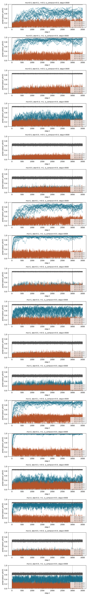
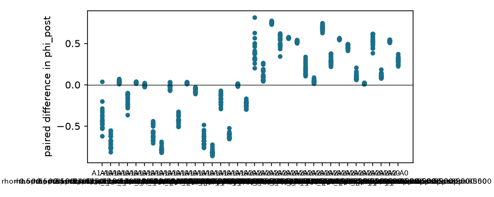

<!-- SPDX-License-Identifier: LicenseRef-SWARM-NC-Research-1.0 -->
# EXP-002 generated run report (confirmatory)

- Generated: 2026-11-24T23:55:21.259508Z by `swarm.report` (code revision of the generator: 075cf7c5f571c03ede9b8d551c3ba43766172a39).
- Experiment: EXP-002; labels: confirmatory.
- Runs: 1080 recorded, 1080 ok, 0 failed.
- Code revision(s) of the runs: 075cf7c5f571c03ede9b8d551c3ba43766172a39 (working tree dirty: False).
- Source files: `runs/*.json` (schema 1.0.0), `metrics.csv`, `run_manifest.json`.

## Per-arm summary (mean, SD across seeds)

| cell | arm | runs | phi_pre | phi_post | cohesion | collisions /agent/100 steps | tau median (censored) | evals/step | runtime s |
| --- | --- | --- | --- | --- | --- | --- | --- | --- | --- |
| rho=0.5, eta=0.1, r=0.5, w_cohesion=0.5, steps=3500 | A0 | 20 | 0.596 (0.148) | 0.576 (0.141) | 0.312 (0.098) | 3.387 (1.134) | 7.5 (2) | 1180.179 (127.203) | 2.06 |
| rho=0.5, eta=0.1, r=0.5, w_cohesion=0.5, steps=3500 | A1 | 20 | 0.166 (0.038) | 0.170 (0.024) | 0.428 (0.114) | 0.739 (0.062) | 9 (0) | 2221.098 (224.981) | 4.18 |
| rho=0.5, eta=0.1, r=0.5, w_cohesion=0.5, steps=3500 | A2 | 20 | 0.984 (0.000) | 0.983 (0.000) | 0.021 (0.004) | 0.178 (0.150) | 1 (0) | 115.378 (8.893) | 0.39 |
| rho=0.5, eta=0.1, r=1, w_cohesion=0.5, steps=3500 | A0 | 20 | 0.888 (0.053) | 0.858 (0.073) | 0.616 (0.142) | 4.553 (1.046) | 2 (1) | 2038.920 (231.554) | 3.29 |
| rho=0.5, eta=0.1, r=1, w_cohesion=0.5, steps=3500 | A1 | 20 | 0.168 (0.042) | 0.170 (0.028) | 0.542 (0.171) | 0.000 (0.000) | 41 (0) | 3999.953 (374.024) | 5.16 |
| rho=0.5, eta=0.1, r=1, w_cohesion=0.5, steps=3500 | A2 | 20 | 0.984 (0.000) | 0.983 (0.000) | 0.057 (0.013) | 0.724 (0.364) | 1 (0) | 486.875 (14.683) | 0.50 |
| rho=0.5, eta=0.3, r=0.5, w_cohesion=0.5, steps=3500 | A0 | 20 | 0.108 (0.025) | 0.108 (0.012) | 0.063 (0.007) | 0.741 (0.085) | 30 (1) | 271.025 (9.432) | 1.58 |
| rho=0.5, eta=0.3, r=0.5, w_cohesion=0.5, steps=3500 | A1 | 20 | 0.145 (0.033) | 0.144 (0.015) | 0.258 (0.070) | 0.563 (0.058) | 42 (0) | 1687.313 (148.903) | 2.48 |
| rho=0.5, eta=0.3, r=0.5, w_cohesion=0.5, steps=3500 | A2 | 20 | 0.859 (0.001) | 0.858 (0.000) | 0.020 (0.003) | 0.186 (0.061) | 1 (0) | 115.108 (5.156) | 0.40 |
| rho=0.5, eta=0.3, r=1, w_cohesion=0.5, steps=3500 | A0 | 20 | 0.338 (0.097) | 0.331 (0.072) | 0.389 (0.076) | 3.068 (0.454) | 18 (2) | 1300.450 (85.926) | 2.87 |
| rho=0.5, eta=0.3, r=1, w_cohesion=0.5, steps=3500 | A1 | 20 | 0.135 (0.026) | 0.144 (0.013) | 0.441 (0.131) | 0.000 (0.000) | 17.5 (0) | 3390.417 (343.875) | 3.77 |
| rho=0.5, eta=0.3, r=1, w_cohesion=0.5, steps=3500 | A2 | 20 | 0.859 (0.001) | 0.858 (0.000) | 0.061 (0.011) | 0.733 (0.173) | 1 (0) | 488.031 (13.516) | 0.51 |
| rho=0.5, eta=0.5, r=0.5, w_cohesion=0.5, steps=3500 | A0 | 20 | 0.071 (0.008) | 0.071 (0.003) | 0.030 (0.002) | 0.349 (0.067) | 126.5 (0) | 147.311 (3.578) | 1.39 |
| rho=0.5, eta=0.5, r=0.5, w_cohesion=0.5, steps=3500 | A1 | 20 | 0.097 (0.012) | 0.099 (0.005) | 0.136 (0.036) | 0.384 (0.042) | 42.5 (0) | 787.612 (65.866) | 1.51 |
| rho=0.5, eta=0.5, r=0.5, w_cohesion=0.5, steps=3500 | A2 | 20 | 0.638 (0.002) | 0.638 (0.001) | 0.020 (0.002) | 0.188 (0.042) | 1 (0) | 116.187 (3.918) | 0.40 |
| rho=0.5, eta=0.5, r=1, w_cohesion=0.5, steps=3500 | A0 | 20 | 0.116 (0.026) | 0.114 (0.010) | 0.143 (0.029) | 1.453 (0.156) | 19 (1) | 667.668 (15.859) | 1.88 |
| rho=0.5, eta=0.5, r=1, w_cohesion=0.5, steps=3500 | A1 | 20 | 0.108 (0.016) | 0.112 (0.005) | 0.290 (0.087) | 0.006 (0.005) | 19.5 (0) | 2007.791 (223.172) | 2.41 |
| rho=0.5, eta=0.5, r=1, w_cohesion=0.5, steps=3500 | A2 | 20 | 0.638 (0.002) | 0.638 (0.001) | 0.066 (0.012) | 0.754 (0.130) | 1 (0) | 489.641 (12.533) | 0.52 |
| rho=1, eta=0.1, r=0.5, w_cohesion=0.5, steps=3500 | A0 | 20 | 0.813 (0.077) | 0.785 (0.069) | 0.456 (0.099) | 4.208 (0.644) | 3.5 (0) | 1706.408 (246.225) | 2.61 |
| rho=1, eta=0.1, r=0.5, w_cohesion=0.5, steps=3500 | A1 | 20 | 0.207 (0.070) | 0.207 (0.034) | 0.621 (0.170) | 0.855 (0.054) | 17.5 (0) | 3217.615 (268.773) | 3.81 |
| rho=1, eta=0.1, r=0.5, w_cohesion=0.5, steps=3500 | A2 | 20 | 0.984 (0.000) | 0.983 (0.000) | 0.031 (0.006) | 0.380 (0.221) | 1 (0) | 224.224 (10.879) | 0.43 |
| rho=1, eta=0.1, r=1, w_cohesion=0.5, steps=3500 | A0 | 20 | 0.934 (0.042) | 0.942 (0.019) | 0.860 (0.092) | 5.078 (1.635) | 1 (0) | 2291.398 (282.877) | 2.92 |
| rho=1, eta=0.1, r=1, w_cohesion=0.5, steps=3500 | A1 | 20 | 0.151 (0.047) | 0.165 (0.027) | 0.856 (0.166) | 0.000 (0.000) | 11 (1) | 5751.838 (389.690) | 4.85 |
| rho=1, eta=0.1, r=1, w_cohesion=0.5, steps=3500 | A2 | 20 | 0.984 (0.000) | 0.983 (0.000) | 0.304 (0.125) | 1.560 (0.585) | 1 (0) | 902.864 (18.056) | 0.65 |
| rho=1, eta=0.3, r=0.5, w_cohesion=0.5, steps=3500 | A0 | 20 | 0.156 (0.038) | 0.167 (0.033) | 0.142 (0.026) | 1.489 (0.253) | 18.5 (0) | 576.043 (25.802) | 1.47 |
| rho=1, eta=0.3, r=0.5, w_cohesion=0.5, steps=3500 | A1 | 20 | 0.147 (0.030) | 0.148 (0.012) | 0.352 (0.082) | 0.664 (0.069) | 34 (0) | 2420.967 (163.742) | 3.02 |
| rho=1, eta=0.3, r=0.5, w_cohesion=0.5, steps=3500 | A2 | 20 | 0.859 (0.001) | 0.858 (0.000) | 0.033 (0.006) | 0.384 (0.092) | 1 (0) | 225.480 (8.189) | 0.44 |
| rho=1, eta=0.3, r=1, w_cohesion=0.5, steps=3500 | A0 | 20 | 0.570 (0.109) | 0.561 (0.048) | 0.717 (0.080) | 4.644 (0.857) | 10.5 (0) | 2085.831 (172.060) | 2.77 |
| rho=1, eta=0.3, r=1, w_cohesion=0.5, steps=3500 | A1 | 20 | 0.146 (0.027) | 0.142 (0.014) | 0.696 (0.175) | 0.000 (0.000) | 14 (0) | 4776.845 (372.181) | 4.03 |
| rho=1, eta=0.3, r=1, w_cohesion=0.5, steps=3500 | A2 | 20 | 0.859 (0.001) | 0.858 (0.000) | 0.300 (0.094) | 1.521 (0.277) | 1 (0) | 906.049 (19.438) | 0.66 |
| rho=1, eta=0.5, r=0.5, w_cohesion=0.5, steps=3500 | A0 | 20 | 0.082 (0.007) | 0.084 (0.004) | 0.055 (0.007) | 0.713 (0.071) | 75.5 (0) | 298.796 (6.890) | 1.46 |
| rho=1, eta=0.5, r=0.5, w_cohesion=0.5, steps=3500 | A1 | 20 | 0.100 (0.011) | 0.106 (0.005) | 0.202 (0.055) | 0.521 (0.057) | 36.5 (0) | 1288.283 (129.220) | 1.50 |
| rho=1, eta=0.5, r=0.5, w_cohesion=0.5, steps=3500 | A2 | 20 | 0.638 (0.002) | 0.638 (0.001) | 0.031 (0.004) | 0.394 (0.072) | 1 (0) | 226.164 (6.554) | 0.44 |
| rho=1, eta=0.5, r=1, w_cohesion=0.5, steps=3500 | A0 | 20 | 0.157 (0.040) | 0.176 (0.025) | 0.489 (0.069) | 2.977 (0.406) | 8.5 (0) | 1317.917 (42.682) | 2.23 |
| rho=1, eta=0.5, r=1, w_cohesion=0.5, steps=3500 | A1 | 20 | 0.115 (0.013) | 0.112 (0.007) | 0.431 (0.103) | 0.013 (0.007) | 35 (1) | 3215.170 (438.203) | 2.50 |
| rho=1, eta=0.5, r=1, w_cohesion=0.5, steps=3500 | A2 | 20 | 0.638 (0.002) | 0.638 (0.001) | 0.316 (0.051) | 1.603 (0.267) | 1 (0) | 910.027 (17.229) | 0.67 |
| rho=2, eta=0.1, r=0.5, w_cohesion=0.5, steps=3500 | A0 | 20 | 0.896 (0.040) | 0.880 (0.039) | 0.533 (0.144) | 4.826 (0.780) | 2 (0) | 2111.063 (213.719) | 2.83 |
| rho=2, eta=0.1, r=0.5, w_cohesion=0.5, steps=3500 | A1 | 20 | 0.229 (0.059) | 0.223 (0.045) | 0.814 (0.130) | 0.943 (0.063) | 25 (1) | 4327.395 (262.963) | 2.66 |
| rho=2, eta=0.1, r=0.5, w_cohesion=0.5, steps=3500 | A2 | 20 | 0.984 (0.000) | 0.983 (0.000) | 0.059 (0.011) | 0.748 (0.237) | 1 (0) | 488.059 (13.216) | 0.51 |
| rho=2, eta=0.1, r=1, w_cohesion=0.5, steps=3500 | A0 | 20 | 0.972 (0.006) | 0.966 (0.005) | 0.981 (0.023) | 6.448 (1.060) | 1 (0) | 3562.185 (370.844) | 3.68 |
| rho=2, eta=0.1, r=1, w_cohesion=0.5, steps=3500 | A1 | 20 | 0.153 (0.043) | 0.156 (0.033) | 0.971 (0.093) | 0.000 (0.000) | 16.5 (0) | 8086.601 (312.189) | 4.61 |
| rho=2, eta=0.1, r=1, w_cohesion=0.5, steps=3500 | A2 | 20 | 0.984 (0.000) | 0.983 (0.000) | 0.989 (0.018) | 3.078 (0.662) | 1 (0) | 2202.584 (31.508) | 0.99 |
| rho=2, eta=0.3, r=0.5, w_cohesion=0.5, steps=3500 | A0 | 20 | 0.290 (0.086) | 0.325 (0.066) | 0.343 (0.075) | 2.826 (0.376) | 1.5 (0) | 1254.865 (67.024) | 1.98 |
| rho=2, eta=0.3, r=0.5, w_cohesion=0.5, steps=3500 | A1 | 20 | 0.174 (0.034) | 0.156 (0.016) | 0.516 (0.142) | 0.797 (0.082) | 33.5 (0) | 3392.101 (296.216) | 2.30 |
| rho=2, eta=0.3, r=0.5, w_cohesion=0.5, steps=3500 | A2 | 20 | 0.859 (0.001) | 0.858 (0.000) | 0.064 (0.008) | 0.754 (0.156) | 1 (0) | 493.261 (13.692) | 0.52 |
| rho=2, eta=0.3, r=1, w_cohesion=0.5, steps=3500 | A0 | 20 | 0.735 (0.051) | 0.746 (0.028) | 0.975 (0.008) | 5.874 (1.283) | 2 (0) | 3331.550 (190.967) | 3.28 |
| rho=2, eta=0.3, r=1, w_cohesion=0.5, steps=3500 | A1 | 20 | 0.139 (0.016) | 0.134 (0.011) | 0.984 (0.049) | 0.000 (0.000) | 29 (0) | 7621.491 (495.919) | 3.63 |
| rho=2, eta=0.3, r=1, w_cohesion=0.5, steps=3500 | A2 | 20 | 0.859 (0.001) | 0.858 (0.000) | 0.990 (0.010) | 3.093 (0.501) | 1 (0) | 2209.481 (27.919) | 1.00 |
| rho=2, eta=0.5, r=0.5, w_cohesion=0.5, steps=3500 | A0 | 20 | 0.108 (0.019) | 0.108 (0.009) | 0.136 (0.016) | 1.381 (0.148) | 37 (0) | 669.133 (13.275) | 1.38 |
| rho=2, eta=0.5, r=0.5, w_cohesion=0.5, steps=3500 | A1 | 20 | 0.109 (0.012) | 0.110 (0.007) | 0.341 (0.102) | 0.689 (0.116) | 31.5 (0) | 2026.872 (145.089) | 1.54 |
| rho=2, eta=0.5, r=0.5, w_cohesion=0.5, steps=3500 | A2 | 20 | 0.638 (0.002) | 0.638 (0.001) | 0.066 (0.011) | 0.781 (0.083) | 1 (0) | 495.068 (8.073) | 0.53 |
| rho=2, eta=0.5, r=1, w_cohesion=0.5, steps=3500 | A0 | 20 | 0.381 (0.074) | 0.344 (0.038) | 0.960 (0.011) | 5.291 (0.477) | 26.5 (0) | 2972.756 (75.613) | 2.73 |
| rho=2, eta=0.5, r=1, w_cohesion=0.5, steps=3500 | A1 | 20 | 0.111 (0.009) | 0.108 (0.006) | 0.755 (0.172) | 0.023 (0.008) | 35.5 (0) | 5460.390 (668.939) | 2.87 |
| rho=2, eta=0.5, r=1, w_cohesion=0.5, steps=3500 | A2 | 20 | 0.638 (0.002) | 0.638 (0.001) | 0.993 (0.003) | 3.120 (0.278) | 1 (0) | 2210.622 (21.046) | 1.01 |

## Paired differences in phi_post (planning quantity)

Within-cell differences between arms for the same seed. The SD feeds the sample-size check of `research/protocol.md` section 6. Not a test of H0.

| contrast | cell | pairs | mean | SD | min | max | projected 95% CI half-width, 18 cells x 10 seeds |
| --- | --- | --- | --- | --- | --- | --- | --- |
| A1-A0 | rho=0.5, eta=0.1, r=0.5, w_cohesion=0.5, steps=3500 | 20 | -0.406 | 0.142 | -0.622 | 0.036 | 0.021 |
| A1-A0 | rho=0.5, eta=0.1, r=1, w_cohesion=0.5, steps=3500 | 20 | -0.688 | 0.078 | -0.815 | -0.550 | 0.011 |
| A1-A0 | rho=0.5, eta=0.3, r=0.5, w_cohesion=0.5, steps=3500 | 20 | 0.037 | 0.017 | 0.008 | 0.073 | 0.003 |
| A1-A0 | rho=0.5, eta=0.3, r=1, w_cohesion=0.5, steps=3500 | 20 | -0.186 | 0.073 | -0.366 | -0.096 | 0.011 |
| A1-A0 | rho=0.5, eta=0.5, r=0.5, w_cohesion=0.5, steps=3500 | 20 | 0.028 | 0.007 | 0.017 | 0.038 | 0.001 |
| A1-A0 | rho=0.5, eta=0.5, r=1, w_cohesion=0.5, steps=3500 | 20 | -0.001 | 0.013 | -0.024 | 0.021 | 0.002 |
| A1-A0 | rho=1, eta=0.1, r=0.5, w_cohesion=0.5, steps=3500 | 20 | -0.578 | 0.082 | -0.704 | -0.437 | 0.012 |
| A1-A0 | rho=1, eta=0.1, r=1, w_cohesion=0.5, steps=3500 | 20 | -0.778 | 0.032 | -0.819 | -0.687 | 0.005 |
| A1-A0 | rho=1, eta=0.3, r=0.5, w_cohesion=0.5, steps=3500 | 20 | -0.019 | 0.032 | -0.067 | 0.031 | 0.005 |
| A1-A0 | rho=1, eta=0.3, r=1, w_cohesion=0.5, steps=3500 | 20 | -0.419 | 0.053 | -0.508 | -0.323 | 0.008 |
| A1-A0 | rho=1, eta=0.5, r=0.5, w_cohesion=0.5, steps=3500 | 20 | 0.022 | 0.007 | 0.011 | 0.034 | 0.001 |
| A1-A0 | rho=1, eta=0.5, r=1, w_cohesion=0.5, steps=3500 | 20 | -0.064 | 0.025 | -0.108 | -0.027 | 0.004 |
| A1-A0 | rho=2, eta=0.1, r=0.5, w_cohesion=0.5, steps=3500 | 20 | -0.657 | 0.071 | -0.761 | -0.481 | 0.010 |
| A1-A0 | rho=2, eta=0.1, r=1, w_cohesion=0.5, steps=3500 | 20 | -0.810 | 0.033 | -0.859 | -0.720 | 0.005 |
| A1-A0 | rho=2, eta=0.3, r=0.5, w_cohesion=0.5, steps=3500 | 20 | -0.169 | 0.065 | -0.293 | -0.068 | 0.010 |
| A1-A0 | rho=2, eta=0.3, r=1, w_cohesion=0.5, steps=3500 | 20 | -0.611 | 0.033 | -0.651 | -0.520 | 0.005 |
| A1-A0 | rho=2, eta=0.5, r=0.5, w_cohesion=0.5, steps=3500 | 20 | 0.002 | 0.011 | -0.021 | 0.018 | 0.002 |
| A1-A0 | rho=2, eta=0.5, r=1, w_cohesion=0.5, steps=3500 | 20 | -0.235 | 0.038 | -0.298 | -0.164 | 0.006 |
| A2-A0 | rho=0.5, eta=0.1, r=0.5, w_cohesion=0.5, steps=3500 | 20 | 0.406 | 0.141 | 0.204 | 0.813 | 0.021 |
| A2-A0 | rho=0.5, eta=0.1, r=1, w_cohesion=0.5, steps=3500 | 20 | 0.125 | 0.073 | 0.044 | 0.265 | 0.011 |
| A2-A0 | rho=0.5, eta=0.3, r=0.5, w_cohesion=0.5, steps=3500 | 20 | 0.751 | 0.012 | 0.728 | 0.773 | 0.002 |
| A2-A0 | rho=0.5, eta=0.3, r=1, w_cohesion=0.5, steps=3500 | 20 | 0.528 | 0.072 | 0.346 | 0.622 | 0.011 |
| A2-A0 | rho=0.5, eta=0.5, r=0.5, w_cohesion=0.5, steps=3500 | 20 | 0.567 | 0.004 | 0.558 | 0.574 | 0.001 |
| A2-A0 | rho=0.5, eta=0.5, r=1, w_cohesion=0.5, steps=3500 | 20 | 0.524 | 0.010 | 0.505 | 0.540 | 0.002 |
| A2-A0 | rho=1, eta=0.1, r=0.5, w_cohesion=0.5, steps=3500 | 20 | 0.198 | 0.069 | 0.109 | 0.339 | 0.010 |
| A2-A0 | rho=1, eta=0.1, r=1, w_cohesion=0.5, steps=3500 | 20 | 0.040 | 0.019 | 0.015 | 0.087 | 0.003 |
| A2-A0 | rho=1, eta=0.3, r=0.5, w_cohesion=0.5, steps=3500 | 20 | 0.692 | 0.033 | 0.627 | 0.748 | 0.005 |
| A2-A0 | rho=1, eta=0.3, r=1, w_cohesion=0.5, steps=3500 | 20 | 0.297 | 0.048 | 0.220 | 0.378 | 0.007 |
| A2-A0 | rho=1, eta=0.5, r=0.5, w_cohesion=0.5, steps=3500 | 20 | 0.554 | 0.005 | 0.545 | 0.562 | 0.001 |
| A2-A0 | rho=1, eta=0.5, r=1, w_cohesion=0.5, steps=3500 | 20 | 0.462 | 0.025 | 0.414 | 0.494 | 0.004 |
| A2-A0 | rho=2, eta=0.1, r=0.5, w_cohesion=0.5, steps=3500 | 20 | 0.103 | 0.039 | 0.062 | 0.207 | 0.006 |
| A2-A0 | rho=2, eta=0.1, r=1, w_cohesion=0.5, steps=3500 | 20 | 0.017 | 0.004 | 0.010 | 0.027 | 0.001 |
| A2-A0 | rho=2, eta=0.3, r=0.5, w_cohesion=0.5, steps=3500 | 20 | 0.533 | 0.066 | 0.385 | 0.617 | 0.010 |
| A2-A0 | rho=2, eta=0.3, r=1, w_cohesion=0.5, steps=3500 | 20 | 0.113 | 0.028 | 0.075 | 0.186 | 0.004 |
| A2-A0 | rho=2, eta=0.5, r=0.5, w_cohesion=0.5, steps=3500 | 20 | 0.530 | 0.009 | 0.511 | 0.546 | 0.001 |
| A2-A0 | rho=2, eta=0.5, r=1, w_cohesion=0.5, steps=3500 | 20 | 0.294 | 0.038 | 0.227 | 0.374 | 0.006 |

## Runtime

- Mean runtime per run: 2.033 s (median 1.793 s, max 6.697 s), measured inside the worker, single thread.
- Projection for 1080 runs at this mean: 36.6 min serial, about 4.6 min with 8 workers (assumes linear scaling and the same per-run cost in every cell; a planning estimate, not a measurement).

## Figures

