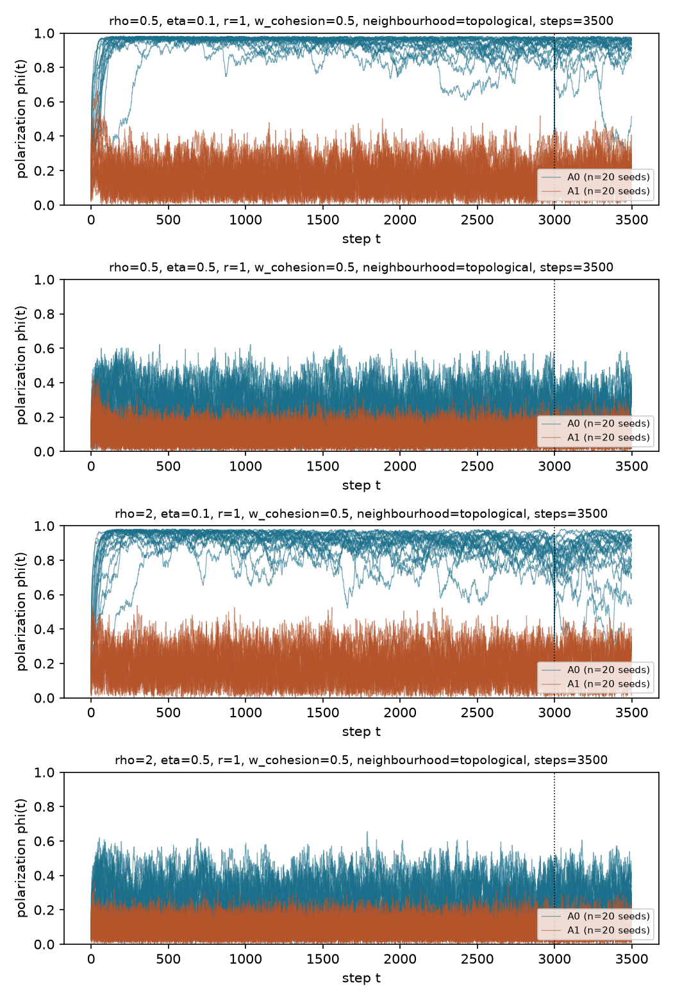
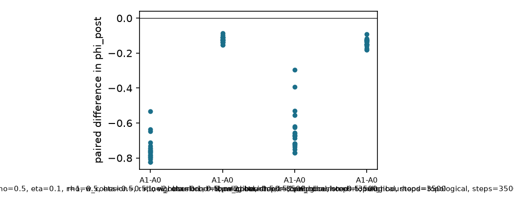

<!-- SPDX-License-Identifier: LicenseRef-SWARM-NC-Research-1.0 -->
# EXP-003 S1 generated run report (confirmatory)

- Generated: 2026-11-25T00:14:01.157612Z by `swarm.report` (code revision of the generator: 075cf7c5f571c03ede9b8d551c3ba43766172a39).
- Experiment: EXP-003; labels: confirmatory.
- Runs: 160 recorded, 160 ok, 0 failed.
- Code revision(s) of the runs: 075cf7c5f571c03ede9b8d551c3ba43766172a39 (working tree dirty: False, True).
- Source files: `runs/*.json` (schema 1.0.0), `metrics.csv`, `run_manifest.json`.

## Per-arm summary (mean, SD across seeds)

| cell | arm | runs | phi_pre | phi_post | cohesion | collisions /agent/100 steps | tau median (censored) | evals/step | runtime s |
| --- | --- | --- | --- | --- | --- | --- | --- | --- | --- |
| rho=0.5, eta=0.1, r=1, w_cohesion=0.5, neighbourhood=topological, steps=3500 | A0 | 20 | 0.935 (0.046) | 0.914 (0.067) | 0.431 (0.156) | 2.719 (1.195) | 2 (0) | 1020.695 (245.119) | 6.72 |
| rho=0.5, eta=0.1, r=1, w_cohesion=0.5, neighbourhood=topological, steps=3500 | A1 | 20 | 0.160 (0.057) | 0.166 (0.025) | 0.359 (0.096) | 0.000 (0.000) | 28 (1) | 2666.238 (227.137) | 7.55 |
| rho=0.5, eta=0.5, r=1, w_cohesion=0.5, neighbourhood=topological, steps=3500 | A0 | 20 | 0.241 (0.075) | 0.219 (0.019) | 0.203 (0.045) | 1.509 (0.242) | 32.5 (0) | 798.975 (44.598) | 6.56 |
| rho=0.5, eta=0.5, r=1, w_cohesion=0.5, neighbourhood=topological, steps=3500 | A1 | 20 | 0.094 (0.010) | 0.096 (0.006) | 0.214 (0.059) | 0.001 (0.001) | 74 (0) | 1824.090 (191.163) | 7.21 |
| rho=2, eta=0.1, r=1, w_cohesion=0.5, neighbourhood=topological, steps=3500 | A0 | 20 | 0.855 (0.068) | 0.826 (0.119) | 0.782 (0.106) | 22.686 (6.858) | 2 (1) | 4415.731 (407.762) | 7.81 |
| rho=2, eta=0.1, r=1, w_cohesion=0.5, neighbourhood=topological, steps=3500 | A1 | 20 | 0.177 (0.045) | 0.178 (0.022) | 0.759 (0.107) | 0.000 (0.000) | 25 (0) | 4619.386 (208.543) | 8.11 |
| rho=2, eta=0.5, r=1, w_cohesion=0.5, neighbourhood=topological, steps=3500 | A0 | 20 | 0.249 (0.053) | 0.235 (0.023) | 0.940 (0.022) | 6.279 (0.549) | 15.5 (0) | 2889.032 (44.455) | 7.31 |
| rho=2, eta=0.5, r=1, w_cohesion=0.5, neighbourhood=topological, steps=3500 | A1 | 20 | 0.096 (0.011) | 0.094 (0.005) | 0.575 (0.119) | 0.002 (0.002) | 69 (0) | 3402.912 (211.542) | 7.80 |

## Paired differences in phi_post (planning quantity)

Within-cell differences between arms for the same seed. The SD feeds the sample-size check of `research/protocol.md` section 6. Not a test of H0.

| contrast | cell | pairs | mean | SD | min | max | projected 95% CI half-width, 18 cells x 10 seeds |
| --- | --- | --- | --- | --- | --- | --- | --- |
| A1-A0 | rho=0.5, eta=0.1, r=1, w_cohesion=0.5, neighbourhood=topological, steps=3500 | 20 | -0.748 | 0.071 | -0.824 | -0.532 | 0.010 |
| A1-A0 | rho=0.5, eta=0.5, r=1, w_cohesion=0.5, neighbourhood=topological, steps=3500 | 20 | -0.123 | 0.017 | -0.154 | -0.085 | 0.003 |
| A1-A0 | rho=2, eta=0.1, r=1, w_cohesion=0.5, neighbourhood=topological, steps=3500 | 20 | -0.647 | 0.123 | -0.770 | -0.295 | 0.018 |
| A1-A0 | rho=2, eta=0.5, r=1, w_cohesion=0.5, neighbourhood=topological, steps=3500 | 20 | -0.140 | 0.022 | -0.182 | -0.092 | 0.003 |

## Runtime

- Mean runtime per run: 7.385 s (median 7.441 s, max 8.259 s), measured inside the worker, single thread.
- Projection for 160 runs at this mean: 19.7 min serial, about 2.5 min with 8 workers (assumes linear scaling and the same per-run cost in every cell; a planning estimate, not a measurement).

## Figures

