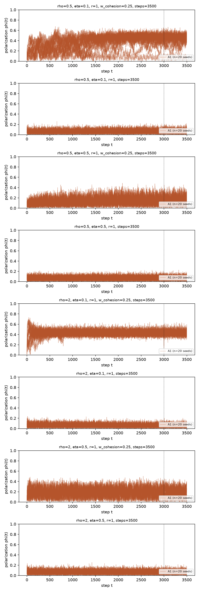

<!-- SPDX-License-Identifier: LicenseRef-SWARM-NC-Research-1.0 -->
# EXP-003 S2 generated run report (confirmatory)

- Generated: 2026-11-25T00:14:06.324689Z by `swarm.report` (code revision of the generator: 075cf7c5f571c03ede9b8d551c3ba43766172a39).
- Experiment: EXP-003; labels: confirmatory.
- Runs: 160 recorded, 160 ok, 0 failed.
- Code revision(s) of the runs: 075cf7c5f571c03ede9b8d551c3ba43766172a39 (working tree dirty: True).
- Source files: `runs/*.json` (schema 1.0.0), `metrics.csv`, `run_manifest.json`.

## Per-arm summary (mean, SD across seeds)

| cell | arm | runs | phi_pre | phi_post | cohesion | collisions /agent/100 steps | tau median (censored) | evals/step | runtime s |
| --- | --- | --- | --- | --- | --- | --- | --- | --- | --- |
| rho=0.5, eta=0.1, r=1, w_cohesion=0.25, steps=3500 | A1 | 20 | 0.426 (0.101) | 0.420 (0.093) | 0.931 (0.136) | 0.000 (0.000) | 3 (1) | 4129.794 (313.178) | 2.45 |
| rho=0.5, eta=0.1, r=1, steps=3500 | A1 | 20 | 0.065 (0.007) | 0.068 (0.004) | 0.188 (0.044) | 0.000 (0.000) | 48 (0) | 1524.847 (207.195) | 1.51 |
| rho=0.5, eta=0.5, r=1, w_cohesion=0.25, steps=3500 | A1 | 20 | 0.159 (0.035) | 0.166 (0.010) | 0.403 (0.121) | 0.001 (0.002) | 9.5 (0) | 2239.353 (219.592) | 1.62 |
| rho=0.5, eta=0.5, r=1, steps=3500 | A1 | 20 | 0.066 (0.006) | 0.064 (0.002) | 0.109 (0.021) | 0.008 (0.004) | 122 (4) | 990.129 (69.752) | 1.18 |
| rho=2, eta=0.1, r=1, w_cohesion=0.25, steps=3500 | A1 | 20 | 0.436 (0.016) | 0.436 (0.016) | 1.000 (0.000) | 0.000 (0.000) | 4.5 (0) | 6274.668 (280.908) | 3.14 |
| rho=2, eta=0.1, r=1, steps=3500 | A1 | 20 | 0.056 (0.008) | 0.059 (0.004) | 0.541 (0.140) | 0.000 (0.000) | 22 (0) | 5228.963 (587.735) | 3.02 |
| rho=2, eta=0.5, r=1, w_cohesion=0.25, steps=3500 | A1 | 20 | 0.206 (0.040) | 0.186 (0.018) | 0.868 (0.113) | 0.004 (0.005) | 39.5 (0) | 5288.088 (324.829) | 2.58 |
| rho=2, eta=0.5, r=1, steps=3500 | A1 | 20 | 0.063 (0.005) | 0.063 (0.002) | 0.399 (0.102) | 0.079 (0.026) | 120 (12) | 3639.799 (472.663) | 2.39 |

## Runtime

- Mean runtime per run: 2.234 s (median 2.435 s, max 3.364 s), measured inside the worker, single thread.
- Projection for 160 runs at this mean: 6.0 min serial, about 0.7 min with 8 workers (assumes linear scaling and the same per-run cost in every cell; a planning estimate, not a measurement).

## Figures

