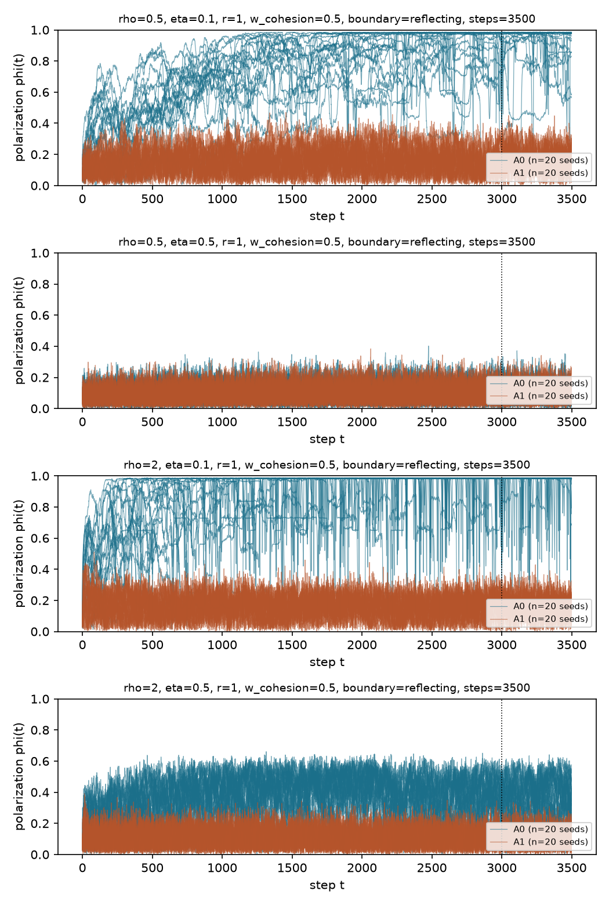
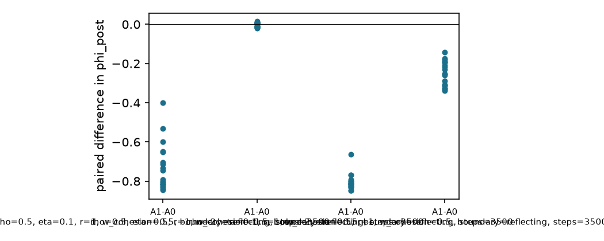

<!-- SPDX-License-Identifier: LicenseRef-SWARM-NC-Research-1.0 -->
# EXP-003 S3 generated run report (confirmatory)

- Generated: 2026-11-25T00:14:11.366500Z by `swarm.report` (code revision of the generator: 075cf7c5f571c03ede9b8d551c3ba43766172a39).
- Experiment: EXP-003; labels: confirmatory.
- Runs: 160 recorded, 160 ok, 0 failed.
- Code revision(s) of the runs: 075cf7c5f571c03ede9b8d551c3ba43766172a39 (working tree dirty: True).
- Source files: `runs/*.json` (schema 1.0.0), `metrics.csv`, `run_manifest.json`.

## Per-arm summary (mean, SD across seeds)

| cell | arm | runs | phi_pre | phi_post | cohesion | collisions /agent/100 steps | tau median (censored) | evals/step | runtime s |
| --- | --- | --- | --- | --- | --- | --- | --- | --- | --- |
| rho=0.5, eta=0.1, r=1, w_cohesion=0.5, boundary=reflecting, steps=3500 | A0 | 20 | 0.858 (0.205) | 0.901 (0.114) | 0.924 (0.125) | 359.844 (259.240) | 1 (0) | 10852.777 (1909.048) | 6.09 |
| rho=0.5, eta=0.1, r=1, w_cohesion=0.5, boundary=reflecting, steps=3500 | A1 | 20 | 0.153 (0.039) | 0.164 (0.024) | 0.579 (0.144) | 0.000 (0.000) | 16.5 (0) | 3607.055 (480.540) | 2.59 |
| rho=0.5, eta=0.5, r=1, w_cohesion=0.5, boundary=reflecting, steps=3500 | A0 | 20 | 0.111 (0.024) | 0.111 (0.011) | 0.138 (0.023) | 1.674 (0.307) | 27 (1) | 642.266 (33.754) | 0.70 |
| rho=0.5, eta=0.5, r=1, w_cohesion=0.5, boundary=reflecting, steps=3500 | A1 | 20 | 0.111 (0.009) | 0.109 (0.006) | 0.225 (0.038) | 0.003 (0.003) | 44 (0) | 1740.059 (170.227) | 1.60 |
| rho=2, eta=0.1, r=1, w_cohesion=0.5, boundary=reflecting, steps=3500 | A0 | 20 | 0.936 (0.130) | 0.966 (0.033) | 0.991 (0.038) | 1712.402 (412.534) | 1 (0) | 16702.554 (1957.858) | 9.80 |
| rho=2, eta=0.1, r=1, w_cohesion=0.5, boundary=reflecting, steps=3500 | A1 | 20 | 0.166 (0.045) | 0.160 (0.021) | 0.908 (0.142) | 0.000 (0.000) | 24 (1) | 7552.537 (685.143) | 3.64 |
| rho=2, eta=0.5, r=1, w_cohesion=0.5, boundary=reflecting, steps=3500 | A0 | 20 | 0.371 (0.080) | 0.360 (0.063) | 0.857 (0.066) | 9.324 (1.555) | 14.5 (0) | 3939.732 (334.081) | 1.88 |
| rho=2, eta=0.5, r=1, w_cohesion=0.5, boundary=reflecting, steps=3500 | A1 | 20 | 0.109 (0.014) | 0.108 (0.007) | 0.679 (0.243) | 0.025 (0.011) | 27 (0) | 5036.669 (770.674) | 2.82 |

## Paired differences in phi_post (planning quantity)

Within-cell differences between arms for the same seed. The SD feeds the sample-size check of `research/protocol.md` section 6. Not a test of H0.

| contrast | cell | pairs | mean | SD | min | max | projected 95% CI half-width, 18 cells x 10 seeds |
| --- | --- | --- | --- | --- | --- | --- | --- |
| A1-A0 | rho=0.5, eta=0.1, r=1, w_cohesion=0.5, boundary=reflecting, steps=3500 | 20 | -0.737 | 0.119 | -0.843 | -0.399 | 0.017 |
| A1-A0 | rho=0.5, eta=0.5, r=1, w_cohesion=0.5, boundary=reflecting, steps=3500 | 20 | -0.003 | 0.011 | -0.020 | 0.015 | 0.002 |
| A1-A0 | rho=2, eta=0.1, r=1, w_cohesion=0.5, boundary=reflecting, steps=3500 | 20 | -0.805 | 0.040 | -0.848 | -0.662 | 0.006 |
| A1-A0 | rho=2, eta=0.5, r=1, w_cohesion=0.5, boundary=reflecting, steps=3500 | 20 | -0.252 | 0.062 | -0.337 | -0.143 | 0.009 |

## Runtime

- Mean runtime per run: 3.640 s (median 2.695 s, max 10.952 s), measured inside the worker, single thread.
- Projection for 160 runs at this mean: 9.7 min serial, about 1.2 min with 8 workers (assumes linear scaling and the same per-run cost in every cell; a planning estimate, not a measurement).

## Figures

