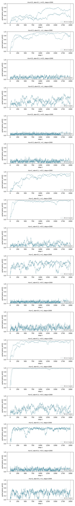

<!-- SPDX-License-Identifier: LicenseRef-SWARM-NC-Research-1.0 -->
# EXP-001 burnin-long (exploratory)

**EXPLORATORY.** These are exploratory simulated runs made before the protocol freeze. They are not findings and are never pooled with confirmatory results.

- Generated: 2026-11-24T16:09:20.000661Z by `swarm.report` (code revision of the generator: 99cc0c444fdfbab6749970b92cad5ebb5c8c2841).
- Experiment: EXP-001; labels: exploratory.
- Runs: 36 recorded, 36 ok, 0 failed.
- Code revision(s) of the runs: 99cc0c444fdfbab6749970b92cad5ebb5c8c2841 (working tree dirty: False).
- Source files: `runs/*.json` (schema 1.0.0), `metrics.csv`, `run_manifest.json`.

## Per-arm summary (mean, SD across seeds)

| cell | arm | runs | phi_pre | phi_post | cohesion | collisions /agent/100 steps | tau median (censored) | evals/step | runtime s |
| --- | --- | --- | --- | --- | --- | --- | --- | --- | --- |
| rho=0.5, eta=0.1, r=0.5, steps=2000 | A0 | 2 | 0.522 (0.221) | n/a | n/a | n/a | n/a (0) | 1137.776 (309.909) | 0.55 |
| rho=0.5, eta=0.1, r=1, steps=2000 | A0 | 2 | 0.792 (0.006) | n/a | n/a | n/a | n/a (0) | 1980.590 (561.906) | 0.62 |
| rho=0.5, eta=0.3, r=0.5, steps=2000 | A0 | 2 | 0.100 (0.013) | n/a | n/a | n/a | n/a (0) | 260.582 (16.737) | 0.28 |
| rho=0.5, eta=0.3, r=1, steps=2000 | A0 | 2 | 0.393 (0.175) | n/a | n/a | n/a | n/a (0) | 1385.436 (31.101) | 0.49 |
| rho=0.5, eta=0.5, r=0.5, steps=2000 | A0 | 2 | 0.079 (0.001) | n/a | n/a | n/a | n/a (0) | 151.695 (2.549) | 0.27 |
| rho=0.5, eta=0.5, r=1, steps=2000 | A0 | 2 | 0.099 (0.019) | n/a | n/a | n/a | n/a (0) | 639.077 (13.922) | 0.36 |
| rho=1, eta=0.1, r=0.5, steps=2000 | A0 | 2 | 0.846 (0.066) | n/a | n/a | n/a | n/a (0) | 1340.970 (131.569) | 0.52 |
| rho=1, eta=0.1, r=1, steps=2000 | A0 | 2 | 0.953 (0.020) | n/a | n/a | n/a | n/a (0) | 2374.305 (118.657) | 0.71 |
| rho=1, eta=0.3, r=0.5, steps=2000 | A0 | 2 | 0.115 (0.064) | n/a | n/a | n/a | n/a (0) | 569.995 (5.254) | 0.38 |
| rho=1, eta=0.3, r=1, steps=2000 | A0 | 2 | 0.591 (0.140) | n/a | n/a | n/a | n/a (0) | 1971.898 (176.606) | 0.64 |
| rho=1, eta=0.5, r=0.5, steps=2000 | A0 | 2 | 0.070 (0.007) | n/a | n/a | n/a | n/a (0) | 290.861 (5.102) | 0.29 |
| rho=1, eta=0.5, r=1, steps=2000 | A0 | 2 | 0.196 (0.020) | n/a | n/a | n/a | n/a (0) | 1383.539 (8.599) | 0.51 |
| rho=2, eta=0.1, r=0.5, steps=2000 | A0 | 2 | 0.916 (0.058) | n/a | n/a | n/a | n/a (0) | 2444.689 (816.789) | 0.71 |
| rho=2, eta=0.1, r=1, steps=2000 | A0 | 2 | 0.966 (0.005) | n/a | n/a | n/a | n/a (0) | 3923.936 (592.540) | 0.93 |
| rho=2, eta=0.3, r=0.5, steps=2000 | A0 | 2 | 0.286 (0.150) | n/a | n/a | n/a | n/a (0) | 1169.283 (133.272) | 0.49 |
| rho=2, eta=0.3, r=1, steps=2000 | A0 | 2 | 0.763 (0.021) | n/a | n/a | n/a | n/a (0) | 3273.897 (361.543) | 0.82 |
| rho=2, eta=0.5, r=0.5, steps=2000 | A0 | 2 | 0.111 (0.024) | n/a | n/a | n/a | n/a (0) | 686.069 (4.322) | 0.39 |
| rho=2, eta=0.5, r=1, steps=2000 | A0 | 2 | 0.326 (0.000) | n/a | n/a | n/a | n/a (0) | 2836.940 (120.505) | 0.74 |

## Runtime

- Mean runtime per run: 0.538 s (median 0.506 s, max 0.992 s), measured inside the worker, single thread.

## Figures

