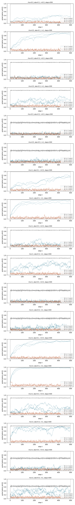

<!-- SPDX-License-Identifier: LicenseRef-SWARM-NC-Research-1.0 -->
# EXP-001 burnin-scan (exploratory)

**EXPLORATORY.** These are exploratory simulated runs made before the protocol freeze. They are not findings and are never pooled with confirmatory results.

- Generated: 2026-11-24T16:09:17.834391Z by `swarm.report` (code revision of the generator: 99cc0c444fdfbab6749970b92cad5ebb5c8c2841).
- Experiment: EXP-001; labels: exploratory.
- Runs: 162 recorded, 162 ok, 0 failed.
- Code revision(s) of the runs: 99cc0c444fdfbab6749970b92cad5ebb5c8c2841 (working tree dirty: False).
- Source files: `runs/*.json` (schema 1.0.0), `metrics.csv`, `run_manifest.json`.

## Per-arm summary (mean, SD across seeds)

| cell | arm | runs | phi_pre | phi_post | cohesion | collisions /agent/100 steps | tau median (censored) | evals/step | runtime s |
| --- | --- | --- | --- | --- | --- | --- | --- | --- | --- |
| rho=0.5, eta=0.1, r=0.5, steps=500 | A0 | 3 | 0.248 (0.152) | n/a | n/a | n/a | n/a (0) | 562.663 (51.329) | 0.10 |
| rho=0.5, eta=0.1, r=0.5, steps=500 | A1 | 3 | 0.057 (0.010) | n/a | n/a | n/a | n/a (0) | 343.589 (23.680) | 0.11 |
| rho=0.5, eta=0.1, r=0.5, steps=500 | A2 | 3 | 0.984 (0.000) | n/a | n/a | n/a | n/a (0) | 115.379 (2.541) | 0.05 |
| rho=0.5, eta=0.1, r=1, steps=500 | A0 | 3 | 0.914 (0.026) | n/a | n/a | n/a | n/a (0) | 1450.637 (340.295) | 0.14 |
| rho=0.5, eta=0.1, r=1, steps=500 | A1 | 3 | 0.064 (0.009) | n/a | n/a | n/a | n/a (0) | 776.428 (47.130) | 0.14 |
| rho=0.5, eta=0.1, r=1, steps=500 | A2 | 3 | 0.984 (0.000) | n/a | n/a | n/a | n/a (0) | 486.719 (2.640) | 0.07 |
| rho=0.5, eta=0.3, r=0.5, steps=500 | A0 | 3 | 0.097 (0.023) | n/a | n/a | n/a | n/a (0) | 225.698 (15.724) | 0.08 |
| rho=0.5, eta=0.3, r=0.5, steps=500 | A1 | 3 | 0.063 (0.004) | n/a | n/a | n/a | n/a (0) | 287.747 (4.741) | 0.10 |
| rho=0.5, eta=0.3, r=0.5, steps=500 | A2 | 3 | 0.859 (0.001) | n/a | n/a | n/a | n/a (0) | 113.563 (4.213) | 0.06 |
| rho=0.5, eta=0.3, r=1, steps=500 | A0 | 3 | 0.333 (0.126) | n/a | n/a | n/a | n/a (0) | 884.368 (105.344) | 0.14 |
| rho=0.5, eta=0.3, r=1, steps=500 | A1 | 3 | 0.061 (0.006) | n/a | n/a | n/a | n/a (0) | 690.082 (40.241) | 0.14 |
| rho=0.5, eta=0.3, r=1, steps=500 | A2 | 3 | 0.859 (0.001) | n/a | n/a | n/a | n/a (0) | 487.438 (2.318) | 0.07 |
| rho=0.5, eta=0.5, r=0.5, steps=500 | A0 | 3 | 0.071 (0.009) | n/a | n/a | n/a | n/a (0) | 138.587 (2.443) | 0.08 |
| rho=0.5, eta=0.5, r=0.5, steps=500 | A1 | 3 | 0.061 (0.007) | n/a | n/a | n/a | n/a (0) | 245.819 (14.841) | 0.10 |
| rho=0.5, eta=0.5, r=0.5, steps=500 | A2 | 3 | 0.639 (0.001) | n/a | n/a | n/a | n/a (0) | 112.901 (7.436) | 0.06 |
| rho=0.5, eta=0.5, r=1, steps=500 | A0 | 3 | 0.112 (0.003) | n/a | n/a | n/a | n/a (0) | 574.174 (22.090) | 0.10 |
| rho=0.5, eta=0.5, r=1, steps=500 | A1 | 3 | 0.063 (0.005) | n/a | n/a | n/a | n/a (0) | 629.319 (21.788) | 0.13 |
| rho=0.5, eta=0.5, r=1, steps=500 | A2 | 3 | 0.639 (0.001) | n/a | n/a | n/a | n/a (0) | 487.540 (3.569) | 0.07 |
| rho=1, eta=0.1, r=0.5, steps=500 | A0 | 3 | 0.724 (0.035) | n/a | n/a | n/a | n/a (0) | 1256.625 (297.261) | 0.14 |
| rho=1, eta=0.1, r=0.5, steps=500 | A1 | 3 | 0.060 (0.001) | n/a | n/a | n/a | n/a (0) | 642.725 (11.223) | 0.13 |
| rho=1, eta=0.1, r=0.5, steps=500 | A2 | 3 | 0.984 (0.000) | n/a | n/a | n/a | n/a (0) | 220.881 (4.496) | 0.06 |
| rho=1, eta=0.1, r=1, steps=500 | A0 | 3 | 0.898 (0.083) | n/a | n/a | n/a | n/a (0) | 1667.556 (172.100) | 0.14 |
| rho=1, eta=0.1, r=1, steps=500 | A1 | 3 | 0.071 (0.015) | n/a | n/a | n/a | n/a (0) | 1425.007 (94.598) | 0.20 |
| rho=1, eta=0.1, r=1, steps=500 | A2 | 3 | 0.984 (0.000) | n/a | n/a | n/a | n/a (0) | 903.130 (19.238) | 0.10 |
| rho=1, eta=0.3, r=0.5, steps=500 | A0 | 3 | 0.125 (0.024) | n/a | n/a | n/a | n/a (0) | 506.831 (49.454) | 0.09 |
| rho=1, eta=0.3, r=0.5, steps=500 | A1 | 3 | 0.062 (0.002) | n/a | n/a | n/a | n/a (0) | 449.979 (22.211) | 0.11 |
| rho=1, eta=0.3, r=0.5, steps=500 | A2 | 3 | 0.859 (0.001) | n/a | n/a | n/a | n/a (0) | 219.493 (9.763) | 0.06 |
| rho=1, eta=0.3, r=1, steps=500 | A0 | 3 | 0.502 (0.079) | n/a | n/a | n/a | n/a (0) | 1583.228 (204.651) | 0.15 |
| rho=1, eta=0.3, r=1, steps=500 | A1 | 3 | 0.065 (0.008) | n/a | n/a | n/a | n/a (0) | 1284.737 (50.490) | 0.19 |
| rho=1, eta=0.3, r=1, steps=500 | A2 | 3 | 0.859 (0.001) | n/a | n/a | n/a | n/a (0) | 906.675 (15.521) | 0.09 |
| rho=1, eta=0.5, r=0.5, steps=500 | A0 | 3 | 0.081 (0.018) | n/a | n/a | n/a | n/a (0) | 289.253 (10.332) | 0.08 |
| rho=1, eta=0.5, r=0.5, steps=500 | A1 | 3 | 0.065 (0.011) | n/a | n/a | n/a | n/a (0) | 440.583 (26.750) | 0.15 |
| rho=1, eta=0.5, r=0.5, steps=500 | A2 | 3 | 0.639 (0.001) | n/a | n/a | n/a | n/a (0) | 220.931 (9.136) | 0.06 |
| rho=1, eta=0.5, r=1, steps=500 | A0 | 3 | 0.165 (0.075) | n/a | n/a | n/a | n/a (0) | 1147.350 (60.703) | 0.12 |
| rho=1, eta=0.5, r=1, steps=500 | A1 | 3 | 0.067 (0.004) | n/a | n/a | n/a | n/a (0) | 1124.092 (54.921) | 0.32 |
| rho=1, eta=0.5, r=1, steps=500 | A2 | 3 | 0.639 (0.001) | n/a | n/a | n/a | n/a (0) | 905.475 (14.568) | 0.09 |
| rho=2, eta=0.1, r=0.5, steps=500 | A0 | 3 | 0.894 (0.008) | n/a | n/a | n/a | n/a (0) | 1500.188 (210.141) | 0.13 |
| rho=2, eta=0.1, r=0.5, steps=500 | A1 | 3 | 0.068 (0.003) | n/a | n/a | n/a | n/a (0) | 1027.565 (24.985) | 0.36 |
| rho=2, eta=0.1, r=0.5, steps=500 | A2 | 3 | 0.984 (0.000) | n/a | n/a | n/a | n/a (0) | 487.026 (1.344) | 0.07 |
| rho=2, eta=0.1, r=1, steps=500 | A0 | 3 | 0.970 (0.003) | n/a | n/a | n/a | n/a (0) | 3178.847 (440.787) | 0.19 |
| rho=2, eta=0.1, r=1, steps=500 | A1 | 3 | 0.065 (0.008) | n/a | n/a | n/a | n/a (0) | 3181.837 (618.752) | 0.50 |
| rho=2, eta=0.1, r=1, steps=500 | A2 | 3 | 0.984 (0.000) | n/a | n/a | n/a | n/a (0) | 2189.805 (41.135) | 0.14 |
| rho=2, eta=0.3, r=0.5, steps=500 | A0 | 3 | 0.292 (0.028) | n/a | n/a | n/a | n/a (0) | 1082.218 (77.489) | 0.12 |
| rho=2, eta=0.3, r=0.5, steps=500 | A1 | 3 | 0.065 (0.002) | n/a | n/a | n/a | n/a (0) | 915.673 (78.762) | 1.23 |
| rho=2, eta=0.3, r=0.5, steps=500 | A2 | 3 | 0.859 (0.001) | n/a | n/a | n/a | n/a (0) | 486.215 (5.907) | 0.08 |
| rho=2, eta=0.3, r=1, steps=500 | A0 | 3 | 0.762 (0.028) | n/a | n/a | n/a | n/a (0) | 3072.562 (371.729) | 0.20 |
| rho=2, eta=0.3, r=1, steps=500 | A1 | 3 | 0.066 (0.004) | n/a | n/a | n/a | n/a (0) | 2931.096 (196.465) | 0.29 |
| rho=2, eta=0.3, r=1, steps=500 | A2 | 3 | 0.859 (0.001) | n/a | n/a | n/a | n/a (0) | 2193.920 (39.626) | 0.16 |
| rho=2, eta=0.5, r=0.5, steps=500 | A0 | 3 | 0.120 (0.009) | n/a | n/a | n/a | n/a (0) | 658.933 (59.318) | 0.09 |
| rho=2, eta=0.5, r=0.5, steps=500 | A1 | 3 | 0.062 (0.001) | n/a | n/a | n/a | n/a (0) | 849.356 (39.636) | 0.15 |
| rho=2, eta=0.5, r=0.5, steps=500 | A2 | 3 | 0.639 (0.001) | n/a | n/a | n/a | n/a (0) | 486.121 (4.804) | 0.09 |
| rho=2, eta=0.5, r=1, steps=500 | A0 | 3 | 0.319 (0.112) | n/a | n/a | n/a | n/a (0) | 2798.845 (141.734) | 0.18 |
| rho=2, eta=0.5, r=1, steps=500 | A1 | 3 | 0.065 (0.007) | n/a | n/a | n/a | n/a (0) | 2593.108 (54.108) | 0.26 |
| rho=2, eta=0.5, r=1, steps=500 | A2 | 3 | 0.639 (0.001) | n/a | n/a | n/a | n/a (0) | 2194.524 (31.503) | 0.15 |

## Runtime

- Mean runtime per run: 0.156 s (median 0.116 s, max 1.901 s), measured inside the worker, single thread.

## Figures

