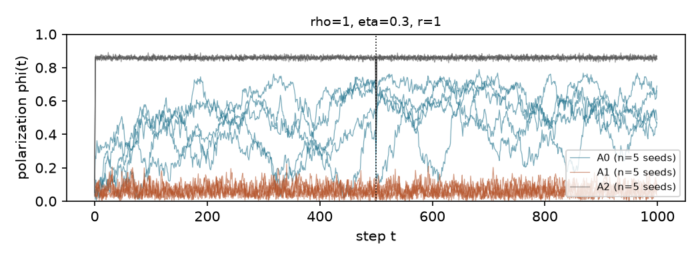
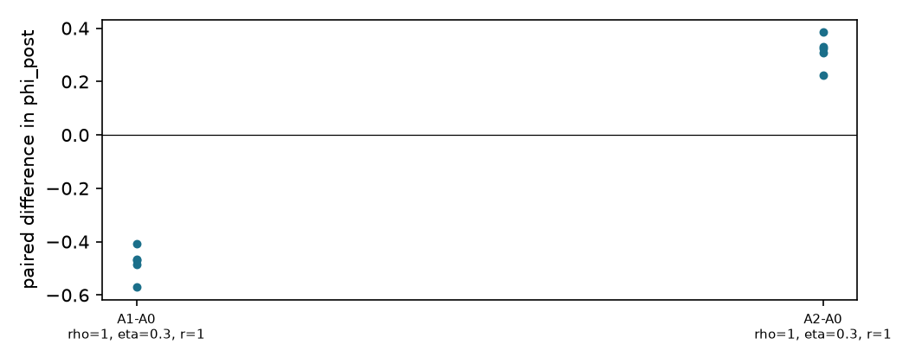

<!-- SPDX-License-Identifier: LicenseRef-SWARM-NC-Research-1.0 -->
# EXP-001 smoke matrix (exploratory)

**EXPLORATORY.** These are exploratory simulated runs made before the protocol freeze. They are not findings and are never pooled with confirmatory results.

- Generated: 2026-11-24T16:09:14.091762Z by `swarm.report` (code revision of the generator: 99cc0c444fdfbab6749970b92cad5ebb5c8c2841).
- Experiment: EXP-001; labels: exploratory.
- Runs: 15 recorded, 15 ok, 0 failed.
- Code revision(s) of the runs: 99cc0c444fdfbab6749970b92cad5ebb5c8c2841 (working tree dirty: False).
- Source files: `runs/*.json` (schema 1.0.0), `metrics.csv`, `run_manifest.json`.

## Per-arm summary (mean, SD across seeds)

| cell | arm | runs | phi_pre | phi_post | cohesion | collisions /agent/100 steps | tau median (censored) | evals/step | runtime s |
| --- | --- | --- | --- | --- | --- | --- | --- | --- | --- |
| rho=1, eta=0.3, r=1 | A0 | 5 | 0.493 (0.187) | 0.544 (0.058) | 0.750 (0.024) | 5.259 (1.298) | 1 (0) | 2156.710 (292.320) | 1.39 |
| rho=1, eta=0.3, r=1 | A1 | 5 | 0.063 (0.008) | 0.064 (0.002) | 0.149 (0.020) | 0.000 (0.000) | 108.5 (1) | 1513.600 (78.554) | 1.79 |
| rho=1, eta=0.3, r=1 | A2 | 5 | 0.860 (0.001) | 0.858 (0.000) | 0.308 (0.077) | 1.442 (0.305) | 1 (0) | 920.655 (26.678) | 0.63 |

## Paired differences in phi_post (planning quantity)

Within-cell differences between arms for the same seed. The SD feeds the sample-size check of `research/protocol.md` section 6. Not a test of H0.

| contrast | cell | pairs | mean | SD | min | max | projected 95% CI half-width, 18 cells x 10 seeds |
| --- | --- | --- | --- | --- | --- | --- | --- |
| A1-A0 | rho=1, eta=0.3, r=1 | 5 | -0.480 | 0.059 | -0.571 | -0.407 | 0.009 |
| A2-A0 | rho=1, eta=0.3, r=1 | 5 | 0.315 | 0.058 | 0.225 | 0.385 | 0.008 |

## Runtime

- Mean runtime per run: 1.269 s (median 1.267 s, max 2.192 s), measured inside the worker, single thread.
- Projection for 540 runs at this mean: 11.4 min serial, about 1.4 min with 8 workers (assumes linear scaling and the same per-run cost in every cell; a planning estimate, not a measurement).

## Figures

